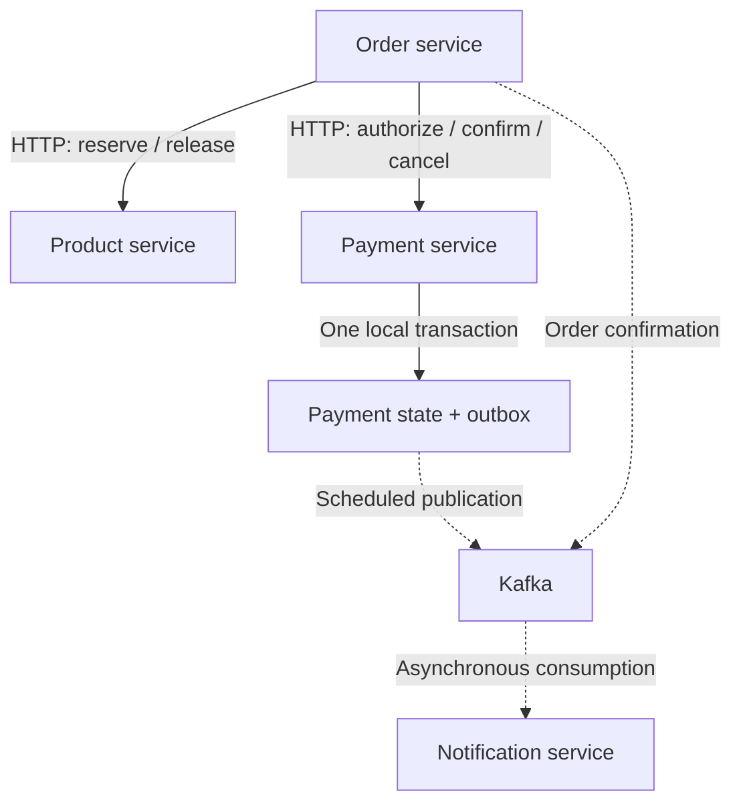

# Engineering case study: recoverable order processing

[Project overview](../readme.md) · [Bhaskar's profile](https://github.com/BKD471)

This personal project explores a concrete backend problem: an order spans inventory, payment and notification services, and any call can fail after another service has already committed its work. The implementation combines synchronous Saga orchestration, asynchronous Kafka notifications and scheduled recovery.

The notes below explain the current implementation and its trade-offs. They are a code walkthrough, not a claim of production scale or a historical architecture decision log. Cloud deployment and CI/CD remain planned.

## Architecture: HTTP for coordination, Kafka for notifications

The order service coordinates inventory and payment operations over HTTP. Payment confirmation stores an outbox record in the payment database; a scheduled publisher sends committed records to Kafka. Order confirmations also go to Kafka, where the notification service consumes events.

This diagram shows the checkout interaction only; gateway, customer lookup, configuration, service discovery and observability components are omitted for clarity. The payment outbox and the order confirmation retry path are separate mechanisms.

## 1. Keep payment confirmation and event creation consistent

**Problem.** Updating a payment and independently sending a Kafka event leaves a failure window: the database can commit while publication fails.

**Implementation.** `confirmPayment` changes an authorized payment to `COMPLETED` and saves a `PaymentOutboxEvent` in the same local database transaction. A separate publisher reads pending events, waits for the Kafka send to complete and then marks the event `SENT`. Send failures stay pending with exponential backoff capped at 60 seconds. Payloads that cannot be mapped to the event schema are quarantined so other records can proceed.

**Trade-off.** Polling adds publication latency and database work. A crash after Kafka accepts an event but before the `SENT` update commits can produce a duplicate. Consumers therefore need idempotent handling; an outbox is not an end-to-end exactly-once guarantee. The repository's notification deduplication uses a 24-hour Redis key, which also gives it a finite replay window.

**Inspect:** [payment transaction](../payment/src/main/java/com/forsaken/ecommerce/payment/service/PaymentServiceImpl.java) · [outbox publisher](../payment/src/main/java/com/forsaken/ecommerce/payment/service/PaymentOutboxPublisher.java) · [retry state](../payment/src/main/java/com/forsaken/ecommerce/payment/model/PaymentOutboxEvent.java) · [consumer deduplication](../notification/src/main/java/com/forsaken/ecommerce/notification/configs/kafka/IdempotencyStore.java)

## 2. Recover a Saga without blindly undoing uncertain work

**Problem.** A timeout does not establish whether a remote operation committed. Recovery workers can also overlap with an earlier request or another worker.

**Implementation.** The Saga reserves inventory, authorizes payment and durably enters `CONFIRMING` before calling payment confirmation. From that state it retries confirmation and publication forward. Failures before that boundary enter compensation, cancelling payment and releasing inventory; incomplete compensation remains available for recovery. Payment operations use order IDs, while inventory reservations use order references to identify repeated requests.

Each recovery worker must obtain a persisted, expiring claim. State transitions check the owner, current state and expiry in a conditional database update. Losing the claim prevents that worker from advancing the order state. The claim currently lasts five minutes.

**Trade-off.** This avoids a cross-service database transaction, but consistency is eventual and compensation is application logic. A claim does not cancel an HTTP call already in flight, so downstream idempotency remains necessary. Claim duration, remote timeouts and long pauses must be evaluated together. Synchronous coordination also makes checkout sensitive to downstream availability.

**Inspect:** [Saga orchestration and compensation](../order/src/main/java/com/forsaken/ecommerce/order/order/service/OrderServiceImpl.java) · [conditional claims and transitions](../order/src/main/java/com/forsaken/ecommerce/order/order/repository/IOrderRepository.java) · [payment idempotency](../payment/src/main/java/com/forsaken/ecommerce/payment/service/PaymentServiceImpl.java) · [inventory reservations](../product/src/main/java/com/forsaken/ecommerce/product/service/ProductServiceImpl.java)

## 3. Separate recovery from reconciliation

**Problem.** Interrupted processing needs another execution attempt, while inconsistent business records need investigation. Treating an unavailable dependency as a missing record can create false findings or unsafe repairs.

**Implementation.** Saga recovery uses Spring Batch with keyset-paged readers. The scheduler restarts a previous `FAILED` or `STOPPED` execution with its original parameters. Per-order claims guard work when executions overlap. Separately, read-only reconciliation checks relationships between orders, payments and reservations. A remote lookup failure propagates to the batch retry/skip policy instead of becoming a business inconsistency finding. Findings are logged and counted; reconciliation does not automatically modify financial or inventory records.

**Trade-off.** Recovery requires durable batch metadata, sensible retry limits and operational visibility. Read-only reconciliation reduces the risk of an incorrect automatic repair, but still needs a follow-up investigation and remediation process. Restart scheduling alone is not proof of crash recovery under real infrastructure failures.

**Inspect:** [recovery batch configuration](../order/src/main/java/com/forsaken/ecommerce/order/batch/SagaRecoveryBatchConfig.java) · [restart scheduling](../order/src/main/java/com/forsaken/ecommerce/order/batch/SagaRecoveryScheduler.java) · [reconciliation rules](../order/src/main/java/com/forsaken/ecommerce/order/order/service/OrderReconciliationService.java) · [reconciliation batch configuration](../order/src/main/java/com/forsaken/ecommerce/order/batch/ReconciliationBatchConfig.java)

## Existing test scenarios

These links point to checked-in test definitions and assertions. They document expected behavior, not a published test-run result or proof of production concurrency guarantees.

| Failure or edge case | Expected behavior expressed by the test | Evidence |
| --- | --- | --- |
| Kafka send fails repeatedly | Event remains pending and its next attempt is delayed | [`publishPending_ShouldKeepEventPending_WhenKafkaSendFails`](../payment/src/test/java/com/forsaken/ecommerce/payment/service/PaymentOutboxPublisherTest.java) |
| One outbox payload cannot be encoded | Quarantine the invalid event and continue with a valid event | [`publishPending_ShouldQuarantineInvalidPayloadAndContinueWithOthers`](../payment/src/test/java/com/forsaken/ecommerce/payment/service/PaymentOutboxPublisherTest.java) |
| Payment confirmation times out | Do not cancel payment or release inventory; retain forward recovery | [`shouldNotCompensateWhenPaymentConfirmationOutcomeIsUncertain`](../order/src/test/java/com/forsaken/ecommerce/order/order/service/OrderServiceImplTest.java) |
| Worker loses ownership | Do not run compensation after the guarded transition fails | [`shouldNotCompensateWhenOwnershipIsLost`](../order/src/test/java/com/forsaken/ecommerce/order/order/service/OrderServiceImplTest.java) |
| Inventory reservation is repeated | Do not decrement stock again for the same order reference | [`reserveProducts_ShouldNotDecrementInventoryAgain_ForSameOrderReference`](../product/src/test/java/com/forsaken/ecommerce/product/service/ProductServiceImplTest.java) |
| A previous batch execution failed | Relaunch it with its original job parameters | [`shouldRestartFailedRunWithItsParameters`](../order/src/test/java/com/forsaken/ecommerce/order/batch/SagaRecoverySchedulerTest.java) |
| Payment lookup is unavailable during reconciliation | Propagate the failure instead of reporting a missing payment | [`paymentLookupFailurePropagatesInsteadOfFlagging`](../order/src/test/java/com/forsaken/ecommerce/order/order/service/OrderReconciliationServiceTest.java) |

## Next validation milestones

1. **Repeatable verification:** CI that publishes test results for these scenarios and a reproducible service environment.
2. **Failure exercises:** process termination around commit/publication boundaries, duplicate delivery, Kafka unavailability and competing recovery workers; record observed outcomes.
3. **Deployment and measurements:** deploy the system and measure checkout latency, outbox backlog age and recovery duration with the workload and environment documented.

These are future milestones, not completed results. The current portfolio evidence is the implementation, its failure-handling paths and the linked tests.
